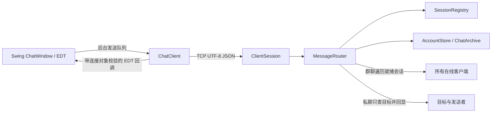

# 架构与线程设计

## 模块关系

`common` 不依赖 Swing。`Message` 为不可变 record，列表在构造时复制。`MessageCodec` 用 Gson 严格解析。`FrameReader` 支持 TCP 分包和粘包，在 16 KiB 处检查大头像帧的类型前缀，允许的头像帧再读至 176 KiB 上限。解码后核对类型和长度，普通帧及归档记录保持原上限。

## 服务端并发

- 一个接受线程执行 ServerSocket.accept。
- 每连接一个读取任务，线程池仅在**先获得 Semaphore 名额后**分配；默认 20，包含未登录连接。读取执行器的线程数和等待队列也各限制为最大连接数，避免退出中的任务尚未返回时持续新增线程；队列满则清理新连接并释放名额。
- 一个定时线程维护绝对握手/直接登录期限。HELLO 或直接登录成功后取消计时，由双向心跳保活；未认证握手连接仍占总连接名额。
- 每个 ClientSession 有独立写锁，所有输出都走 send，完整 JSON 帧和 flush 在锁内完成。
- 注册表使用 ConcurrentHashMap，成员变化和快照由短 synchronized 临界区统一保护；临界区内没有网络 I/O。

登录分“预留”和“就绪”：同一注册锁内 `putIfAbsent` 预留名称并绑定会话；网络锁外写 LOGIN_OK；再原子转为就绪、增加 revision 并取快照。这样既保证并发重名只一个赢家，又保证 LOGIN_OK 先于业务事件。广播和私聊均排除未就绪会话。

群聊从**会话**提取发送者，生成时间，向当前就绪会话逐个发送。写入失败清理该目标后继续。私聊先校验自己/目标，查找目标会话，先给目标写入、成功后给发送者写回显，不调用广播。私聊正文不写服务端日志。

## 清理与关闭

ClientSession 用 AtomicBoolean 保证清理一次。先关闭 Socket（不等待写锁，从而可打断阻塞读写），取消登录期限；释放连接名额，注册表按 `remove(userId, session)` 条件移除。只有已就绪成员被移除才增加版本、推列表并通知下线；拒绝的重复登录不能删掉原会话。

关闭服务端与接受/登记连接使用同一个生命周期短锁，防止停止时遗漏刚接受的 Socket。停止后关闭所有会话、关闭执行器并有界等待线程结束。JVM shutdown hook 处理 Ctrl+C。协议错误隔离在连接读取循环内，不终止接受线程。

## 客户端与 EDT

每次连接创建独立 Connection 对象，包含新 Socket、原子请求编号、单线程发送执行器及最多 64 项等待队列、一个读取线程。发送线程完成 DNS 和 TCP 连接，发出 HELLO 或直登 LOGIN，再启动读取线程。界面走 HELLO 时，收到 HELLO_OK 后可输入注册或登录资料。收到 LOGIN_OK 才进入 CONNECTED，所有协议写入在后台执行。

客户端传入 `SwingUtilities::invokeLater` 作为回调执行器。每个回调在实际执行时检查 `active == connection`，所以已排队的旧 EDT 回调不会覆盖新连接。旧读取线程发生异常时也仅能终止自己的 Connection。连接内按请求编号跟踪发送期限及写入是否开始，窗口在 EDT 按会话保留本地发送气泡。服务端回显用正式记录替换匹配气泡，写入中断关闭当前连接并更新未完成的发送状态。重连时重新认证并加载本人归档，当前窗口仅在地址和用户名均匹配时保留原会话状态。

主动断开直接关闭 TCP，服务端通过 EOF 完成退出；协议同样支持显式 LOGOUT。窗口关闭调用 client.close，释放 Socket、发送执行器和计时器。客户端线程设为 daemon 作为进程退出兜底；测试验证重复连接后线程结束。

## 双向心跳

`common/HeartbeatSettings` 保存本端间隔与响应期限，可从 JVM 系统属性读取，已有构造入口保留，另提供显式配置构造入口供测试/嵌入使用。`common/Heartbeat` 每连接持有独立单线程调度器，只维护一个待响应编号、相对时间期限及下一轮探测；只有匹配 PONG 才完成本轮并安排下一轮。PING/PONG 在网络层消费，沿原回调执行器传播的只有连接状态变化，不接触 Swing、ConversationStore 或聊天路由。

客户端心跳写入共用原有 64 项后台发送队列；服务端每会话增加一个后台心跳写执行器（8 项有界等待队列），写入仍经 ClientSession.send 的同一写锁。两端每连接都有独立 watchdog，定时线程不执行心跳帧写入，探测期限在入队前开始；因此同连接读线程卡在不完整帧、写线程或写锁等待时仍能关闭 Socket。队列拒绝同样关闭该连接，避免悄悄丢失控制帧。

心跳超时沿用幂等关闭，取消定时任务并停止心跳写执行器；先关闭 Socket 打断该连接的阻塞读写，再释放名称/名额并推列表。关闭后的 monitor 无法重新启动，旧 Connection 的定时回调仅引用自身，不能关闭重连 Socket。服务端停止时有界等待所收集会话的心跳线程退出。每个已登录服务端会话最多增加两个线程，桌面客户端每连接增加一个 watchdog，适用既定课程规模；不是大规模连接优化方案。

现有服务端同步业务广播仍可能等待其他慢连接，心跳关闭自身连接后触发的下线广播也使用原路径；各连接的独立 watchdog 不受另一连接写入等待阻塞。心跳未引入通用业务输出队列，也不提供消息重发、送达确认或自动重连。默认期限、非法与过期 PONG 处理和混合版本限制见 [协议](protocol.md)。

在线列表仍由 ChatClient 按版本单调更新并在重连时重置。界面改造后，ConversationStore 在 EDT 保存分会话历史、草稿、未读数与“必须重新选择”状态：原私聊对象离线后仍显示该会话和草稿，但禁止发送；重新上线也不自动恢复发送许可，必须明确重新选择联系人或公共聊天室。原 ConversationSelection 类及其回归测试保留，网络接口不变。

ChatWindow 只组装界面与调用原有网络入口；client/ui 下的 ConversationList、MessageTimeline、ConnectionPanel 等组件分开管理展示。消息用纯文本 StyledDocument 渲染为左右气泡，字体回退支持 emoji，不解释 HTML，也不新增消息类型。ResponsiveShell 将双栏界面在小于 760 像素时转换为会话列表/聊天页单列导航。具体组件与扩展点见 [UI 设计说明](ui-design.md)。

外观由窗口持有的 AppearanceSettings 和 ThemePalette 管理，ChatTheme 按语义角色更新组件，MessageTimeline 按色板失效已有气泡缓存；切换主题不创建新连接或清空会话。WallpaperPanel 只绘制选定的纯色/渐变，ChatPopupMenu 为各菜单提供统一样式。AppearancePanel 维护独立预览草稿，应用后由 AppearancePreferences 在本机用户目录保存外观参数；读写失败不影响聊天业务。

消息展示昵称由路由层按账号读取。实时事件使用发送时的昵称，历史页在读取授权归档后查找当前昵称。历史页的昵称位于外层响应，归档与导出复用原 ChatRecord。客户端将昵称传入 ConversationStore 的展示条目，MessageTimeline 按稳定账号分组并用视口坐标计算头像位置。数据传递与绘制各自在网络线程和 EDT 延续既有分工。

v5 增加独立展示资料帧。服务端在登录、资料保存和本人历史加载时发送有关账号的昵称和头像，账号版本随资料原子保存。会话写锁保护同一账号资料的去重和发送顺序。客户端读取线程解码共享头像，ConversationStore 在 EDT 用用户名缓存最新资料，列表、标题和时间线基于缓存重新呈现。头像数据不写入聊天历史或导出记录。

2026-11-02 外观增量：暗色面板/次级表面改为中性近黑，默认背景墨黑渐变；旧 v1 默认色对在加载时映射至墨黑，其他自选配色保留，新保存为外观配置 v2（与聊天协议 v4 无关）。ColorField 封装 HEX 与色盘入口，ColorPicker 在 EDT 用 HSV 模型支持拖动及键盘调色，只更新外观草稿。ChatTheme 统一按钮的单次文字绘制与禁用色，避免默认禁用浮雕文字重影；网络、认证和会话状态不变。

## 取舍

采用 Java 17 兼容 API、Maven 单工程和普通阻塞 TCP，适合课程规模。正常 5～10 客户端的收发与状态管理可自动验证。同步广播在慢客户端停止读取时可能被写入阻塞；没有实现通用有界服务端业务输出队列或慢连接淘汰。心跳已补充静默失联检测，时限仍受 JVM/系统暂停和调度影响；用户名现需密码认证，传输仍无 TLS，应仅用于可信课程局域网。

## 账号认证与导出（2026-10-29）

AccountStore 独立于路由与 Swing，保存昵称及用户名对应的随机盐/密码散列，账号文件临时写出后原子发布；采用 JDK PBKDF2WithHmacSHA256、600000 次、128 位盐、256 位输出，参考 [OWASP Password Storage](https://cheatsheetseries.owasp.org/cheatsheets/Password_Storage_Cheat_Sheet.html)。注册/密码计算在连接后台线程，不进入 EDT。账号文件名和历史文件名以 UTF-8 十六进制用户名作为键，避免 Windows 大小写冲突；ChatServer 独占数据目录文件锁。

MessageRouter 对所有业务统一检查 ready（HELLO 与握手后的 PING/PONG、REGISTER/LOGIN 为未认证入口），密码通过后仍先预留名称、发 LOGIN_OK 再就绪。连接就是会话凭证，不复用请求 userId/from 认证，无 bearer token 或固定会话 TTL；沿现有幂等关闭释放身份。LOGIN 失败不区分账号不存在或密码错误，不发送密码/散列给其他客户端。

ChatArchive 将路由时在线可访问者的聊天事件追加到其账号 JSONL 文件，稳定 UUID、公共或双方会话 ID、ISO 时间由服务端生成。归档先于网络投递，归档存在不证明已送达；跨多个账号文件的写入没有事务保证，磁盘故障可能部分落盘并返回 STORAGE_ERROR，无自动重试。服务端提供本人授权归档的历史分页加载与导出；不提供任意文件或他人用户查询、离线投递。

每连接的历史查询和导出各有一个独立 RandomAccessFile 快照，使用固定末尾和随机游标。客户端消费一条再请求下一条。归档读取有 16 KiB 行上限，关闭、完成或替换时释放句柄。HistoryExport 逐条写 JSON/CSV。ChatClient 按 requestId 关联导出，逐页计时，经回调执行器通知 EDT。已确认覆盖的导出使用原子替换，首次写入拒绝覆盖后来出现的同名文件，失败会清理临时文件。

## 启动认证与个人资料组件（2026-10-30）

ChatClient 新增 SERVER_CONNECTED（仅完成 HELLO）与 AUTHENTICATING；保留旧 connect 直登入口供现有调用。连接对象隔离所有状态/资料回调；注册成功只触发下一次 LOGIN，只有 LOGIN_OK 将会话置为 CONNECTED。认证响应超时关闭 Socket，错密码/重名则回到 SERVER_CONNECTED；握手后心跳先于身份启动，不赋予聊天、资料或导出权限。

ChatWindow 通过 CardLayout 在 WelcomePanel 与 ResponsiveShell 之间切换；ConnectionPanel 只负责地址/端口，AuthenticationPanel 管理登录/注册表单，WelcomePanel 桌面分栏、窄屏纵向滚动。UserIdentityButton、ProfilePanel、ProfileAvatar 独立呈现本人资料，避免把会话展示元数据和路由用户名混用。显式退出清除 Store 身份及草稿；切换账号改由下节 ClientSessions 延迟交接，故障重连保留原有窗口历史策略。

AccountStore 支持兼容旧 JSON 的可选头像和创建时间。本人资料修改先原子替换文件，再更新内存账号。v6 的 AvatarImporter 在 SwingWorker 内限制原图大小和像素，并按原图短边选择 256 或 512 像素方形输出，AvatarData 再校验尺寸、格式和长度。展示资料另行同步，本人注册时间仍通过本人资料响应提供。改密使用独立请求编号验证当前密码，在服务端生成新盐及散列后原子更新，原会话继续使用。改密和资料响应各自计时，客户端会忽略对应的迟到回执。

## 系统文件对话框与密码显隐（2026-10-31）

FileDialogs 将异步完成统一回调到 EDT；WindowsFilePicker 在后台 STA 调用原生 IFileOpenDialog，关闭后释放 IShellItem、CoTaskMem 路径和 COM 对象，最终 CoUninitialize。图片过滤与目录选择只影响选择界面，导出文件命名/安全发布和后台头像校验不变，Windows 失败明确报错。参考 [Microsoft IFileOpenDialog](https://learn.microsoft.com/en-us/windows/win32/api/shobjidl_core/nn-shobjidl_core-ifileopendialog)、[选项定义](https://learn.microsoft.com/en-us/windows/win32/api/shobjidl_core/ne-shobjidl_core-_fileopendialogoptions) 与 [JNA Ole32](https://github.com/java-native-access/jna/blob/5.14.0/contrib/platform/src/com/sun/jna/platform/win32/Ole32.java)。

PasswordInput 仅切换 JPasswordField echoChar；两框独立，清理凭据/换模式/断线恢复默认遮罩。密码不新增持久化/日志，不修改认证协议。

## 账号成功后交接（2026-10-31）

ClientSessions 在 EDT 分离当前 Slot 与待切换 Slot，分别持有独立 ChatClient；网络/心跳仍在各自后台任务，旧账号保持接收与授权归档。切换页只处理候选连接的认证状态/错误，不覆盖旧 ConversationStore、本人资料或连接状态。失败/取消保留旧会话，返回聊天取消候选并清理其凭据、恢复旧服务端地址；认证过程中也可返回。

收到候选 LOGIN_OK 的有效本人资料后，在同一次 EDT 回调中将其设为当前 Slot、失效旧回调路由，再关闭旧客户端并通知窗口清除旧 Store/搜索/草稿。即使跨服务端使用相同用户名，也按会话替换清理，防止仅比较用户名泄露旧记录；异步文件选择完成时另检查会话代数。候选失败、连接上限、取消后迟到事件均不能关闭原会话或恢复已取消候选。

未改变协议 v3；切换期间额外占一个连接名额，新身份成功前旧身份继续在线。服务端拒绝额外连接时保留旧账号并提示重试；原连接若自身网络故障，则无法保证继续在线，此时不再提供返回失效聊天的按钮，候选仍可重连/登录。

## 本人历史恢复与删除（2026-11-01）

ChatArchive 继续按账号隔离文件，新增历史快照和按会话/消息 ID 的流式重写删除；删除只处理当前连接账号文件，不访问对方文件，失败不发布。每账号跟踪打开的游标，删除前关闭快照，避免 Windows 文件占用及旧导出返回已删除内容。MessageRouter 将聊天归档/投递与删除确认串行化，防止旧实时事件越过删除确认；保留慢客户端可能阻塞同步写入的限制。

HistoryChannel 每连接维护历史/删除请求编号、期限及取消代数，独立于导出与 Swing；每条记录由展示回调消费后再翻页，防止 EDT 消费积压，不在网络读取线程积累整份历史。ChatClient 定时器移除取消任务，断线关闭历史操作；读取失败保留已收记录并提供重新加载，删除结果未确认不能提前移除 UI 数据。

ChatWindow 登录成功/账号交接后发起加载，ConversationStore 在 EDT 以 messageId 合并、按时间插入，不按 requestId 去重；历史不制造未读，历史先到时后续实时副本仍只计一次未读。加载合并保留草稿/在线状态，节流刷新界面；离线联系人由历史创建且禁发，仍需明确重选。右键删除和整会话清空都先确认，收到成功才更新 Store 并重新加载，失败不伪装已删除；已删除的消息不在以后导出中。

窗口最终仍持有全部已加载消息，未实现容量淘汰/长期堆验证。历史范围是本人此前有权接收的归档，旧版未归档内容不能凭空恢复；不是离线消息。
