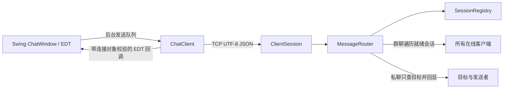

# 架构与线程设计

## 模块关系

`common` 不依赖 Swing。`Message` 为不可变 record；列表在构造时复制。`MessageCodec` 用 Gson 严格解析并拒绝字段类型隐式转换。`FrameReader` 在有限长字节缓冲区上解码 UTF-8，支持 TCP 分包/粘包；超长在读取时拒绝。`Validation` 共享用户标识、正文规则。

## 服务端并发

- 一个接受线程执行 ServerSocket.accept。
- 每连接一个读取任务，线程池仅在**先获得 Semaphore 名额后**分配；默认 20，包含未登录连接。读取执行器的线程数和等待队列也各限制为最大连接数，避免退出中的任务尚未返回时持续新增线程；队列满则清理新连接并释放名额。
- 一个定时线程维护绝对登录期限。成功登录后取消计时，无聊天空闲超时。
- 每个 ClientSession 有独立写锁，所有输出都走 send，完整 JSON 帧和 flush 在锁内完成。
- 注册表使用 ConcurrentHashMap，成员变化和快照由短 synchronized 临界区统一保护；临界区内没有网络 I/O。

登录分“预留”和“就绪”：同一注册锁内 `putIfAbsent` 预留名称并绑定会话；网络锁外写 LOGIN_OK；再原子转为就绪、增加 revision 并取快照。这样既保证并发重名只一个赢家，又保证 LOGIN_OK 先于业务事件。广播和私聊均排除未就绪会话。

群聊从**会话**提取发送者，生成时间，向当前就绪会话逐个发送。写入失败清理该目标后继续。私聊先校验自己/目标，查找目标会话，先给目标写入、成功后给发送者写回显，不调用广播。私聊正文不写服务端日志。

## 清理与关闭

ClientSession 用 AtomicBoolean 保证清理一次。先关闭 Socket（不等待写锁，从而可打断阻塞读写），取消登录期限；释放连接名额，注册表按 `remove(userId, session)` 条件移除。只有已就绪成员被移除才增加版本、推列表并通知下线；拒绝的重复登录不能删掉原会话。

关闭服务端与接受/登记连接使用同一个生命周期短锁，防止停止时遗漏刚接受的 Socket。停止后关闭所有会话、关闭执行器并有界等待线程结束。JVM shutdown hook 处理 Ctrl+C。协议错误隔离在连接读取循环内，不终止接受线程。

## 客户端与 EDT

每次连接创建独立 Connection 对象，包含新 Socket、原子请求编号、单线程发送执行器及最多 64 项等待队列、一个读取线程。连接/DNS/登录写入都在发送线程；成功发出 LOGIN 后启动读取线程，收到 LOGIN_OK 才将状态切到 CONNECTED。界面按钮仅校验和入队，不执行网络写入。

客户端传入 `SwingUtilities::invokeLater` 作为回调执行器。每个回调在实际执行时检查 `active == connection`，所以已排队的旧 EDT 回调不会覆盖新连接。旧读取线程发生异常时也仅能终止自己的 Connection。发送出错关闭当前连接并明确提示“未确认”，不自动重发。

主动断开直接关闭 TCP，服务端通过 EOF 完成退出；协议同样支持显式 LOGOUT。窗口关闭调用 client.close，释放 Socket、发送执行器和计时器。客户端线程设为 daemon 作为进程退出兜底；测试验证重复连接后线程结束。

在线列表按版本单调更新并在重连时重置。ConversationSelection 独立保存目标与“必须重新选择”状态：原私聊对象离线后 target 清空但禁止发送，重新上线也不自动选择，必须点击群聊或选择在线用户。文本通过 JTextArea 纯文本显示，原样保留换行，不解释 HTML。

## 取舍

采用 Java 17 兼容 API、Maven 单工程和普通阻塞 TCP，适合课程规模。正常 5～10 客户端的收发与状态管理可自动验证。同步广播在慢客户端停止读取时可能被写入阻塞；没有实现有界服务端输出队列或慢连接淘汰。没有心跳，静默网络黑洞可能长期不产生 EOF；未声称及时发现静默断网。用户名称无认证，传输无 TLS，应仅用于可信课程局域网。
