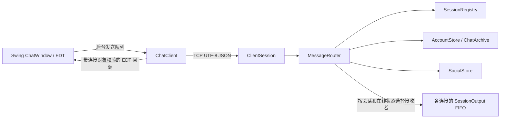

# 架构与线程设计

## 模块关系

`common` 不依赖 Swing。`Message` 为不可变 record，列表在构造时复制。`MessageCodec` 用 Gson 严格解析。`FrameReader` 支持 TCP 分包和粘包，在 16 KiB 处检查大头像帧的类型前缀，允许的头像帧再读至 176 KiB 上限。解码后核对类型和长度，普通帧及归档记录保持原上限。

## 服务端并发

- 一个接受线程执行 ServerSocket.accept。
- 每连接一个读取任务，线程池先取得连接名额再分配；局域网默认 20，TLS 默认 140。读取执行器的线程数和等待队列各受总连接数限制；队列满时清理新连接并释放名额。
- 服务端计时器维护初始握手或直接登录期限。收到 HELLO 后启动心跳，TLS 模式另安排认证期限；未认证连接仍占总连接名额，TLS 模式还限制未认证连接数量。
- 每个 ClientSession 通过 SessionOutput 持有有界 FIFO 和独立写线程。队列锁只保护入队、取队和关闭，完整 JSON 帧的写入和 flush 由写线程执行。
- 注册表使用 ConcurrentHashMap，成员变化和快照由短 synchronized 临界区统一保护；临界区内没有网络 I/O。

登录先在注册锁内预留名称并绑定会话，在锁外等待 LOGIN_OK 写出，再原子转为就绪、增加 revision 并取快照。这样并发登录只有一个同名会话成功，LOGIN_OK 先于业务事件。实时投递只选择就绪会话。

群聊从认证会话提取发送者，完成归档后编码一次。公共消息发给所有就绪账号，独立群组发给就绪的当前成员。私聊校验好友或私聊许可并归档，在线目标入队后回显发送者，离线好友在归档完成后回显发送者。

## 清理与关闭

ClientSession 用 AtomicBoolean 保证清理一次。取消登录期限，关闭发送队列与 Socket，使阻塞读写退出，再释放心跳、查询和导出资源。释放连接名额时，注册表按 `remove(userId, session)` 条件移除。只有已就绪成员被移除才增加版本、推列表并通知下线。

关闭服务端与接受/登记连接使用同一个生命周期短锁，防止停止时遗漏刚接受的 Socket。停止后关闭所有会话、关闭执行器并有界等待线程结束。JVM shutdown hook 处理 Ctrl+C。协议错误隔离在连接读取循环内，不终止接受线程。

## 客户端与 EDT

每次连接创建独立 Connection 对象，包含新 Socket、原子请求编号、单线程发送执行器及最多 64 项等待队列、一个读取线程。发送线程完成 DNS 和 TCP 连接，发出 HELLO 或直登 LOGIN，再启动读取线程。界面走 HELLO 时，收到 HELLO_OK 后可输入注册或登录资料。收到 LOGIN_OK 才进入 CONNECTED，所有协议写入在后台执行。

客户端传入 `SwingUtilities::invokeLater` 作为回调执行器。每个回调在实际执行时检查 `active == connection`，所以已排队的旧 EDT 回调不会覆盖新连接。旧读取线程发生异常时也仅能终止自己的 Connection。连接内按请求编号跟踪发送期限及写入是否开始，窗口在 EDT 按会话保留本地发送气泡。服务端回显用正式记录替换匹配气泡，写入中断关闭当前连接并更新未完成的发送状态。重连时重新认证并加载本人归档，当前窗口仅在地址和用户名均匹配时保留原会话状态。

主动断开直接关闭 TCP，服务端通过 EOF 完成退出；协议同样支持显式 LOGOUT。窗口关闭调用 client.close，释放 Socket、发送执行器和计时器。客户端线程设为 daemon 作为进程退出兜底；测试验证重复连接后线程结束。

## 双向心跳

`common/HeartbeatSettings` 保存本端间隔与响应期限，可从 JVM 系统属性读取，已有构造入口保留，另提供显式配置构造入口供测试/嵌入使用。`common/Heartbeat` 每连接持有独立单线程调度器，只维护一个待响应编号、相对时间期限及下一轮探测；只有匹配 PONG 才完成本轮并安排下一轮。PING/PONG 在网络层消费，沿原回调执行器传播的只有连接状态变化，不接触 Swing、ConversationStore 或聊天路由。

客户端心跳写入共用原有 64 项后台发送队列；服务端每会话增加一个后台心跳写执行器（8 项有界等待队列），写入仍经 ClientSession.send 的同一写锁。两端每连接都有独立 watchdog，定时线程不执行心跳帧写入，探测期限在入队前开始；因此同连接读线程卡在不完整帧、写线程或写锁等待时仍能关闭 Socket。队列拒绝同样关闭该连接，避免悄悄丢失控制帧。

心跳超时沿用幂等关闭，取消定时任务并停止心跳写执行器；先关闭 Socket 打断该连接的阻塞读写，再释放名称/名额并推列表。关闭后的 monitor 无法重新启动，旧 Connection 的定时回调仅引用自身，不能关闭重连 Socket。服务端停止时有界等待所收集会话的心跳线程退出。每个已登录服务端会话最多增加两个线程，桌面客户端每连接增加一个 watchdog，适用既定课程规模；不是大规模连接优化方案。

服务端心跳与业务共用逐连接发送队列。每条连接的独立 watchdog 监测该连接的心跳，其他连接继续发消息。默认期限和非法与过期 PONG 处理见 [协议](protocol.md)。

在线列表由 ChatClient 按版本单调更新并在重连时重置。ConversationStore 在 EDT 保存分会话历史、草稿、未读及社交状态。已获许可的陌生人离线后保留会话与草稿，重新上线后重选会话。好友离线时允许归档留言。

ChatWindow 只组装界面与调用原有网络入口；client/ui 下的 ConversationList、MessageTimeline、ConnectionPanel 等组件分开管理展示。消息用纯文本 StyledDocument 渲染为左右气泡，字体回退支持 emoji，不解释 HTML，也不新增消息类型。ResponsiveShell 将双栏界面在小于 760 像素时转换为会话列表/聊天页单列导航。具体组件与扩展点见 [UI 设计说明](ui-design.md)。

外观由窗口持有的 AppearanceSettings 和 ThemePalette 管理，ChatTheme 按语义角色更新组件，MessageTimeline 按色板失效已有气泡缓存；切换主题不创建新连接或清空会话。WallpaperPanel 只绘制选定的纯色/渐变，ChatPopupMenu 为各菜单提供统一样式。AppearancePanel 维护独立预览草稿，应用后由 AppearancePreferences 在本机用户目录保存外观参数；读写失败不影响聊天业务。

消息展示昵称由路由层按账号读取。实时事件使用发送时的昵称，历史页在读取授权归档后查找当前昵称。历史页的昵称位于外层响应，归档与导出复用原 ChatRecord。客户端将昵称传入 ConversationStore 的展示条目，MessageTimeline 按稳定账号分组并用视口坐标计算头像位置。数据传递与绘制各自在网络线程和 EDT 延续既有分工。

v5 增加独立展示资料帧。服务端在登录、资料保存和本人历史加载时发送有关账号的昵称和头像，账号版本随资料原子保存。每连接的资料版本表保护去重与入队顺序。客户端读取线程解码共享头像，ConversationStore 在 EDT 用用户名缓存最新资料，列表、标题和时间线基于缓存重新呈现。聊天历史和导出记录只关联账号标识。

2026-11-02 外观增量：暗色面板/次级表面改为中性近黑，默认背景墨黑渐变；旧 v1 默认色对在加载时映射至墨黑，其他自选配色保留，新保存为外观配置 v2（与聊天协议 v4 无关）。ColorField 封装 HEX 与色盘入口，ColorPicker 在 EDT 用 HSV 模型支持拖动及键盘调色，只更新外观草稿。ChatTheme 统一按钮的单次文字绘制与禁用色，避免默认禁用浮雕文字重影；网络、认证和会话状态不变。

## 取舍

采用 Java 17 兼容 API、Maven 单工程和阻塞 TCP。TLS 模式在认证前执行证书和主机名检查。单机容量取决于连接读写、认证 CPU、磁盘和网络资源。回环负载证据见 [测试报告](test-report.md)。

## 账号认证、数据库与导出

AccountStore 独立于路由与 Swing，使用区分大小写的用户名作为数据库主键。密码采用 JDK PBKDF2WithHmacSHA256、600000 次、128 位随机盐和 256 位输出。注册和密码计算在连接后台线程执行，账号缓存只在事务提交后更新。[OWASP Password Storage](https://cheatsheetseries.owasp.org/cheatsheets/Password_Storage_Cheat_Sheet.html)

MessageRouter 对所有业务统一检查 ready（HELLO 与握手后的 PING/PONG、REGISTER/LOGIN 为未认证入口），密码通过后仍先预留名称、发 LOGIN_OK 再就绪。连接就是会话凭证，不复用请求 userId/from 认证，无 bearer token 或固定会话 TTL；沿现有幂等关闭释放身份。LOGIN 失败不区分账号不存在或密码错误，不发送密码/散列给其他客户端。

ChatServer 独占数据目录文件锁。`SqliteDatabase` 初始化 `ltalk.db`，用应用标识和表结构版本检查数据库，启用外键和 WAL。写事务经同一连接串行提交，查询使用独立读连接。[SQLite WAL](https://sqlite.org/wal.html)

表结构由 `sqlite-schema-v1.sql` 和 `sqlite-migrate-v2.sql` 建立。v2 在同一事务中替换旧群号、更新成员、请求和历史中的关联键，并添加撤回标记。命令行优先使用显式 `-Dltalk.dataDir`，省略时默认使用当前目录的 `data-sqlite/`。若 `data-sqlite/` 下尚无数据库，而 `data/ltalk.db` 已存在，则沿用早期 SQLite 库。云端 systemd 单元显式使用 `/var/lib/ltalk`。[启动说明](../README.md#启动与操作)

ChatArchive 对每条消息保存一个 UUID 和内部递增序号，另保存供客户端显示的 UTC 时间。消息提交后才进行实时投递。公共消息由认证账号按本人删除规则读取。私聊在同一事务内写入消息及双方的可见记录。独立群历史按成员授权区间和本人删除规则查询。

每个历史或导出游标固定消息序号上界和当时的群授权区间数。服务端按序号分块读取，每次读取后释放查询连接，客户端仍逐条消费。HistoryExport 逐条写 JSON/CSV。ChatClient 按 requestId 关联导出，逐页计时，经回调执行器通知 EDT。

ArchiveView 在同一个读事务中校验 UUID 锚点并查询页面。会话索引和序号用于分页及定位，摘要按会话取最新可见记录。搜索仍按原规则匹配正文、当前昵称及用户名，稀疏关键词可能扫描较多可见记录。

## 启动认证与个人资料组件（2026-10-30）

ChatClient 新增 SERVER_CONNECTED（仅完成 HELLO）与 AUTHENTICATING；保留旧 connect 直登入口供现有调用。连接对象隔离所有状态/资料回调；注册成功只触发下一次 LOGIN，只有 LOGIN_OK 将会话置为 CONNECTED。认证响应超时关闭 Socket，错密码/重名则回到 SERVER_CONNECTED；握手后心跳先于身份启动，不赋予聊天、资料或导出权限。

ChatWindow 通过 CardLayout 在 WelcomePanel 与 ResponsiveShell 之间切换；ConnectionPanel 只负责地址/端口，AuthenticationPanel 管理登录/注册表单，WelcomePanel 桌面分栏、窄屏纵向滚动。UserIdentityButton、ProfilePanel、ProfileAvatar 独立呈现本人资料，避免把会话展示元数据和路由用户名混用。显式退出清除 Store 身份及草稿；切换账号改由下节 ClientSessions 延迟交接，故障重连保留原有窗口历史策略。

本人资料修改先提交数据库事务，再更新内存账号。AvatarImporter 在 SwingWorker 内限制原图大小和像素，并按原图短边选择 256 或 512 像素方形输出，AvatarData 再校验尺寸、格式和长度。展示资料另行同步，注册时间通过本人资料响应提供。改密请求验证当前密码，生成新盐及散列后提交，原会话继续使用。改密和资料响应各自计时，客户端会忽略对应的迟到回执。

## 系统文件对话框与密码显隐（2026-10-31）

FileDialogs 将异步完成统一回调到 EDT；WindowsFilePicker 在后台 STA 调用原生 IFileOpenDialog，关闭后释放 IShellItem、CoTaskMem 路径和 COM 对象，最终 CoUninitialize。图片过滤与目录选择只影响选择界面，导出文件命名/安全发布和后台头像校验不变，Windows 失败明确报错。参考 [Microsoft IFileOpenDialog](https://learn.microsoft.com/en-us/windows/win32/api/shobjidl_core/nn-shobjidl_core-ifileopendialog)、[选项定义](https://learn.microsoft.com/en-us/windows/win32/api/shobjidl_core/ne-shobjidl_core-_fileopendialogoptions) 与 [JNA Ole32](https://github.com/java-native-access/jna/blob/5.14.0/contrib/platform/src/com/sun/jna/platform/win32/Ole32.java)。

PasswordInput 仅切换 JPasswordField echoChar；两框独立，清理凭据/换模式/断线恢复默认遮罩。密码不新增持久化/日志，不修改认证协议。

## 账号成功后交接（2026-10-31）

ClientSessions 在 EDT 分离当前 Slot 与待切换 Slot，分别持有独立 ChatClient；网络/心跳仍在各自后台任务，旧账号保持接收与授权归档。切换页只处理候选连接的认证状态/错误，不覆盖旧 ConversationStore、本人资料或连接状态。失败/取消保留旧会话，返回聊天取消候选并清理其凭据、恢复旧服务端地址；认证过程中也可返回。

收到候选 LOGIN_OK 的有效本人资料后，在同一次 EDT 回调中将其设为当前 Slot、失效旧回调路由，再关闭旧客户端并通知窗口清除旧 Store/搜索/草稿。即使跨服务端使用相同用户名，也按会话替换清理，防止仅比较用户名泄露旧记录；异步文件选择完成时另检查会话代数。候选失败、连接上限、取消后迟到事件均不能关闭原会话或恢复已取消候选。

未改变协议 v3；切换期间额外占一个连接名额，新身份成功前旧身份继续在线。服务端拒绝额外连接时保留旧账号并提示重试；原连接若自身网络故障，则无法保证继续在线，此时不再提供返回失效聊天的按钮，候选仍可重连/登录。

## 本人历史恢复与删除（2026-11-01）

ChatArchive 用数据库事务更新当前账号的单条隐藏记录或会话清空截止序号。提交后使该账号的旧游标失效。MessageRouter 将归档、聊天事件入队和删除回执入队串行化，同一连接由独立发送线程按顺序写入。

## TLS、公网限制与发送队列（2026-11-17）

服务端先接受原始 Socket，受独立期限约束，在连接工作线程执行 TLS 握手。客户端用填入的主机名进行 JSSE 端点校验，成功后进入聊天协议。关闭原始 Socket 能解除连接线程上的阻塞读写。

每连接 FIFO 上限为 128 帧、512 KiB，另允许一帧在写入。路由的顺序锁保护收发、引用校验、删除和社交请求的处理顺序，消息在锁内入队，由写线程完成网络 I/O。拥塞连接由服务端计时执行器关闭，登录回应和初始资料可在各自读线程有期限地等待该连接写完。认证有独立的未认证连接名额与有界频率表，密码散列在账号写入临界区外计算，提交前再次检查账号或口令材料。[部署手册](deployment.md)

HistoryChannel 每连接维护浏览、历史和删除的请求编号及期限，独立于导出与 Swing。桌面浏览在读线程收齐至多 20 条后把一页交给 EDT。ConversationStore 为会话列表缓存摘要，在进入会话时合并最近记录及实时事件。ChatWindow 丢弃重新加载或会话身份改变前的浏览结果。定位使用独立的上下文列表，实时事件继续进入原时间线。ChatClient 定时器移除取消任务，断线关闭历史操作。浏览失败保留已显示的记录，删除超时可通过重载核对结果。

ChatWindow 登录或交接后发起加载。ConversationStore 在 EDT 按 messageId 合并并按时间插入。历史不增加未读，随后到达的实时消息只计一次。合并保留草稿及在线状态。右键删除和整会话清空先确认，成功后更新 Store 和重载历史，已删除的消息不在之后的导出中。

## 社交关系和群历史

SocialStore 负责好友、独立私聊许可、请求及群成员。事务写入实际变化的行，提交后发布新的内存快照。消息路由串行化群成员变更、聊天归档与投递。好友离线留言与在线私聊使用同一归档路径，对方登录后按本人可见范围读取。

加入时查询群内最近 100 条的起始序号，退出或解散时用当前归档序号结束授权。每次入群建立一个新区间，已经关闭的区间保留。群资料及社交状态由 SocialChannel 在网络读取线程收齐一页，完整状态在 EDT 应用。请求、目录和好友列表由 SocialDialog 展示，ConversationStore 保存会话、草稿及发送权限。账号切换和断线使原有的回调及对话框失效。

打开独立群信息卡片时，ChatWindow 经 SocialChannel 请求 `GROUP_MEMBERS` 并收齐名单。服务端在 SocialStore 的短临界区内确认请求者当前仍在群内并取得成员快照，逐页响应。需要同步的头像通过 `DISPLAY_PROFILE` 在对应行前发送，写出等待在消息修改锁之外。成员变化通过 `SOCIAL_CHANGED` 通知当前成员刷新名单。在线状态来自 `USER_LIST`，公共聊天室也直接以此生成成员名单。[协议](protocol.md#好友陌生人私聊与独立群组v6-扩展)

`ConversationInfoPanel` 负责卡片呈现，ChatWindow 保留当前卡片及名单加载状态，关闭卡片、切换会话或断线后忽略失效的名单结果。群成员和好友仍通过同一份 `ConversationStore` 展示资料渲染。左侧分类从已有会话摘要筛选，切换分类不更改当前聊天目标。[界面设计](ui-design.md#交互规则)

群号和用户名的展示文本与可复制的原始标识分开传给卡片，ChatWindow 复用正文复制的剪贴板写入和错误处理。`GroupTransferDialog` 使用卡片已经收齐的群成员名单在本机筛选，成员刷新后按用户名保留仍有效的选择。确认时窗口核对登录代数、群组和管理员状态，再通过既有 `GROUP_TRANSFER` 提交。服务端检查提交者权限和接任者的成员资格。

## 未读定位和引用回复

ConversationStore 按会话保存尚未确认阅读的实时消息，首条记录提供滚动锚点。ChatWindow 在打开会话时先定位，再清除当时的未读批次。定位请求期间新增的消息保留为未读。MessageTimeline 提供未读分隔、正文复制和引用跳转。旧消息分页、焦点切换和账号切换沿用 EDT 与后台回调的边界。

引用草稿独立于正文字段，按会话保存。发送时 ChatArchive 校验目标 UUID、可见性和撤回状态。归档保存引用编号，当前窗口用已加载的原消息生成预览，超出当前范围时按会话请求上下文。编号和正文的传输继续沿用普通帧上限。

窗口保留全部已加载消息，尚未验证长时间运行下的堆占用。公共共享归档从升级后的第一条公共消息开始。

## 消息撤回

`ChatArchive` 使用认证身份和服务端归档时间判断撤回资格。SQLite 事务在原消息行标记撤回并清空正文、引用和附件元数据，保留消息 ID 与序号供历史分页和已有引用定位。已有附件文件仍计入附件配额，新的下载请求按撤回后的记录校验。[撤回协议](protocol.md#消息撤回v7)

`MessageRouter` 按聊天投递顺序发布撤回事件。导出暂存的行在提交后替换，已取出但尚未发出的历史页会复核撤回标记，搜索页在有并发撤回时重算游标。在线窗口在 EDT 更新会话摘要、消息和已打开的搜索结果。重连后按服务端历史恢复撤回提示。

## Emoji、图片和附件

`EmojiPicker` 将选中的 Unicode 字符插入当前草稿。ChatWindow 捕获打开文件选择器时的目标会话与登录代数，确认窗口显示目标和文件名。选择发送且登录仍有效时，`AttachmentChannel` 使用已有登录连接申请票据，再独立连接相同端口传输原始字节。传输取消及身份变更关闭传输连接。对话框、消息状态与回调留在 Swing EDT，文件读取、写入和图片解码在后台。

`AttachmentStore` 管理短期一次性票据、独立传输的资源上限和服务端文件。上传时先把数据写入临时文件，图片解码成功后生成有界缩略图。发布时在聊天路由的有序区内重查发送权限，先保存原文件，再使用既有归档和实时路由。下载从目标会话的历史快照确认本人可见性，传输期间无须占用聊天路由锁。

归档中的附件元数据随原消息分页、搜索和定位。删除本人记录时，原文件按共享存储方式保留。若原文件已保存但归档结果不确定，文件仍保留，以支持可能已写成功的私聊副本。配额覆盖已保存文件和活跃上传的预留容量，每个文件至少按 4 KiB 计入配额。临时文件在传输结束或服务端下次启动时清理。
