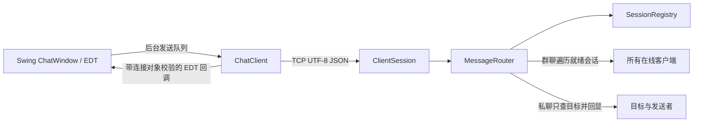

# 架构与线程设计

## 模块关系

`common` 不依赖 Swing。`Message` 为不可变 record；列表在构造时复制。`MessageCodec` 用 Gson 严格解析并拒绝字段类型隐式转换。`FrameReader` 在有限长字节缓冲区上解码 UTF-8，支持 TCP 分包/粘包；超长在读取时拒绝。`Validation` 共享用户标识、正文规则。

## 服务端并发

- 一个接受线程执行 ServerSocket.accept。
- 每连接一个读取任务，线程池仅在**先获得 Semaphore 名额后**分配；默认 20，包含未登录连接。读取执行器的线程数和等待队列也各限制为最大连接数，避免退出中的任务尚未返回时持续新增线程；队列满则清理新连接并释放名额。
- 一个定时线程维护绝对登录期限。成功登录后取消计时，无聊天空闲超时。
- 每个 ClientSession 有独立写锁，所有输出都走 send，完整 JSON 帧和 flush 在锁内完成。
- 注册表使用 ConcurrentHashMap，成员变化和快照由短 synchronized 临界区统一保护；临界区内没有网络 I/O。

登录分“预留”和“就绪”：同一注册锁内 `putIfAbsent` 预留名称并绑定会话；网络锁外写 LOGIN_OK；再原子转为就绪、增加 revision 并取快照。这样既保证并发重名只一个赢家，又保证 LOGIN_OK 先于业务事件。广播和私聊均排除未就绪会话。

群聊从**会话**提取发送者，生成时间，向当前就绪会话逐个发送。写入失败清理该目标后继续。私聊先校验自己/目标，查找目标会话，先给目标写入、成功后给发送者写回显，不调用广播。私聊正文不写服务端日志。

## 清理与关闭

ClientSession 用 AtomicBoolean 保证清理一次。先关闭 Socket（不等待写锁，从而可打断阻塞读写），取消登录期限；释放连接名额，注册表按 `remove(userId, session)` 条件移除。只有已就绪成员被移除才增加版本、推列表并通知下线；拒绝的重复登录不能删掉原会话。

关闭服务端与接受/登记连接使用同一个生命周期短锁，防止停止时遗漏刚接受的 Socket。停止后关闭所有会话、关闭执行器并有界等待线程结束。JVM shutdown hook 处理 Ctrl+C。协议错误隔离在连接读取循环内，不终止接受线程。

## 客户端与 EDT

每次连接创建独立 Connection 对象，包含新 Socket、原子请求编号、单线程发送执行器及最多 64 项等待队列、一个读取线程。连接/DNS/登录写入都在发送线程；成功发出 LOGIN 后启动读取线程，收到 LOGIN_OK 才将状态切到 CONNECTED。界面按钮仅校验和入队，不执行网络写入。

客户端传入 `SwingUtilities::invokeLater` 作为回调执行器。每个回调在实际执行时检查 `active == connection`，所以已排队的旧 EDT 回调不会覆盖新连接。旧读取线程发生异常时也仅能终止自己的 Connection。发送出错关闭当前连接并明确提示“未确认”，不自动重发。

主动断开直接关闭 TCP，服务端通过 EOF 完成退出；协议同样支持显式 LOGOUT。窗口关闭调用 client.close，释放 Socket、发送执行器和计时器。客户端线程设为 daemon 作为进程退出兜底；测试验证重复连接后线程结束。

## 双向心跳

`common/HeartbeatSettings` 保存本端间隔与响应期限，可从 JVM 系统属性读取，已有构造入口保留，另提供显式配置构造入口供测试/嵌入使用。`common/Heartbeat` 每连接持有独立单线程调度器，只维护一个待响应编号、相对时间期限及下一轮探测；只有匹配 PONG 才完成本轮并安排下一轮。PING/PONG 在网络层消费，沿原回调执行器传播的只有连接状态变化，不接触 Swing、ConversationStore 或聊天路由。

客户端心跳写入共用原有 64 项后台发送队列；服务端每会话增加一个后台心跳写执行器（8 项有界等待队列），写入仍经 ClientSession.send 的同一写锁。两端每连接都有独立 watchdog，定时线程不执行心跳帧写入，探测期限在入队前开始；因此同连接读线程卡在不完整帧、写线程或写锁等待时仍能关闭 Socket。队列拒绝同样关闭该连接，避免悄悄丢失控制帧。

心跳超时沿用幂等关闭，取消定时任务并停止心跳写执行器；先关闭 Socket 打断该连接的阻塞读写，再释放名称/名额并推列表。关闭后的 monitor 无法重新启动，旧 Connection 的定时回调仅引用自身，不能关闭重连 Socket。服务端停止时有界等待所收集会话的心跳线程退出。每个已登录服务端会话最多增加两个线程，桌面客户端每连接增加一个 watchdog，适用既定课程规模；不是大规模连接优化方案。

现有服务端同步业务广播仍可能等待其他慢连接，心跳关闭自身连接后触发的下线广播也使用原路径；各连接的独立 watchdog 不受另一连接写入等待阻塞。心跳未引入通用业务输出队列，也不提供消息重发、送达确认或自动重连。默认期限、非法与过期 PONG 处理和混合版本限制见 [协议](protocol.md)。

在线列表仍由 ChatClient 按版本单调更新并在重连时重置。界面改造后，ConversationStore 在 EDT 保存分会话历史、草稿、未读数与“必须重新选择”状态：原私聊对象离线后仍显示该会话和草稿，但禁止发送；重新上线也不自动恢复发送许可，必须明确重新选择联系人或公共聊天室。原 ConversationSelection 类及其回归测试保留，网络接口不变。

ChatWindow 只组装界面与调用原有网络入口；client/ui 下的 ConversationList、MessageTimeline、ConnectionPanel 等组件分开管理展示。消息用纯文本 StyledDocument 渲染为左右气泡，字体回退支持 emoji，不解释 HTML，也不新增消息类型。ResponsiveShell 将双栏界面在小于 760 像素时转换为会话列表/聊天页单列导航。具体组件与扩展点见 [UI 设计说明](ui-design.md)。

外观由窗口持有的 AppearanceSettings 和 ThemePalette 管理，ChatTheme 按语义角色更新组件，MessageTimeline 按色板失效已有气泡缓存；切换主题不创建新连接或清空会话。WallpaperPanel 只绘制选定的纯色/渐变，ChatPopupMenu 为各菜单提供统一样式。AppearancePanel 维护独立预览草稿，应用后由 AppearancePreferences 在本机用户目录保存外观参数；读写失败不影响聊天业务。

## 取舍

采用 Java 17 兼容 API、Maven 单工程和普通阻塞 TCP，适合课程规模。正常 5～10 客户端的收发与状态管理可自动验证。同步广播在慢客户端停止读取时可能被写入阻塞；没有实现通用有界服务端业务输出队列或慢连接淘汰。心跳已补充静默失联检测，时限仍受 JVM/系统暂停和调度影响；用户名现需密码认证，传输仍无 TLS，应仅用于可信课程局域网。

## 账号认证与导出（2026-10-29）

AccountStore 独立于路由与 Swing，保存昵称及用户名对应的随机盐/密码散列，账号文件临时写出后原子发布；采用 JDK PBKDF2WithHmacSHA256、600000 次、128 位盐、256 位输出，参考 [OWASP Password Storage](https://cheatsheetseries.owasp.org/cheatsheets/Password_Storage_Cheat_Sheet.html)。注册/密码计算在连接后台线程，不进入 EDT。账号文件名和历史文件名以 UTF-8 十六进制用户名作为键，避免 Windows 大小写冲突；ChatServer 独占数据目录文件锁。

MessageRouter 在 REGISTER/LOGIN 外统一检查 ready，密码通过后仍先预留名称、发 LOGIN_OK 再就绪。连接就是会话凭证，不复用请求 userId/from 认证，无 bearer token 或固定会话 TTL；沿现有幂等关闭释放身份。LOGIN 失败不区分账号不存在或密码错误，不发送密码/散列给其他客户端。

ChatArchive 将路由时在线可访问者的聊天事件追加到其账号 JSONL 文件，稳定 UUID、公共或双方会话 ID、ISO 时间由服务端生成。归档先于网络投递，归档存在不证明已送达；跨多个账号文件的写入没有事务保证，磁盘故障可能部分落盘并返回 STORAGE_ERROR，无自动重试。服务端只提供本人完整历史导出，不提供任意文件或他人用户查询、离线投递和 UI 历史回放。

每连接最多一份 RandomAccessFile 快照，固定末尾和随机游标，单条响应后由客户端请求下一条；文件读取有 16 KiB 行上限，关闭/完成/替换会释放句柄。HistoryExport 逐条写 JSON/CSV，不积累全部记录；ChatClient 按 requestId 关联导出、独立逐页超时，晚到的取消响应忽略；完成原子移动、失败删除临时文件，经回调执行器通知 EDT。注册通过独立短连接返回用户名，不自动登录。昵称暂仅作为账号资料，现有列表/私聊仍按稳定用户名路由。
