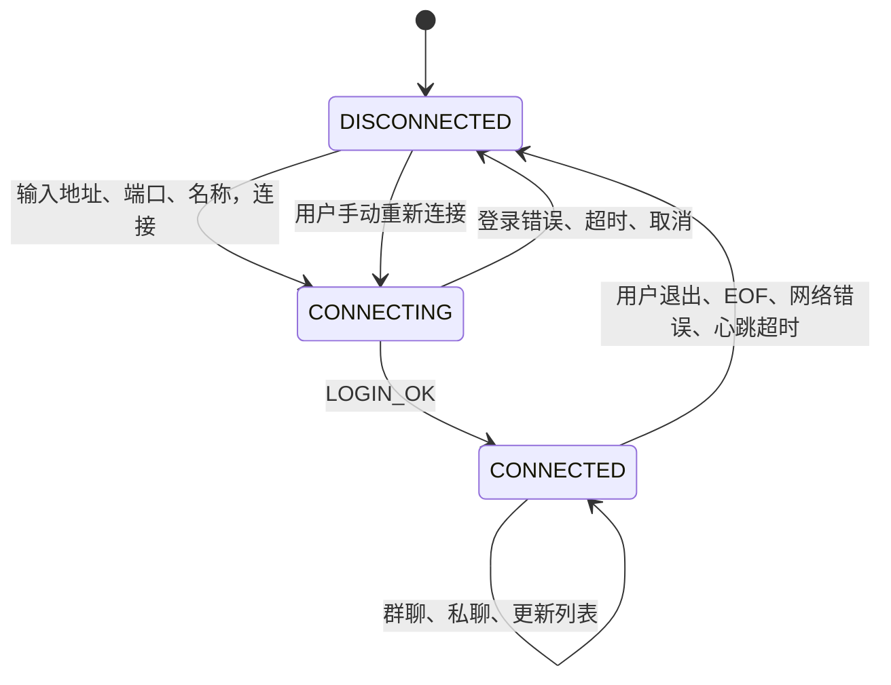

# MVP 需求与操作流程

基线：根目录《局域网聊天项目任务拆解.md》。范围是单服务端、单公共聊天室、5～10 个正常桌面客户端；私聊由服务端路由，无客户端直连。2026-10-27 增加 X1 双向心跳；X2～X6 扩展未实现。

| 需求 | 实现与约束 | 验证入口 |
| --- | --- | --- |
| R-01 配置并启动 | CLI 端口/IP/连接上限，默认 9000/0.0.0.0/20 | ChatServerTest.occupiedPortAndShutdownAreObservable |
| R-02 唯一用户加入 | strip 后 `[A-Za-z0-9_]{1,20}`；重名保留原会话；LOGIN_OK 最先返回 | duplicateLogin / concurrentSameName 测试 |
| R-03 在线列表 | 加入/离开推送全量快照；版本递增；重连重置本地版本 | userListVersions / logoutAbruptClose 测试 |
| R-04 群聊 | 全部就绪用户各收到一次；包括发送者；新用户不补历史 | groupEchoPrivateIsolationAndNoHistory |
| R-05 私聊 | 只发目标和发送者；不存在/自己/缺目标反馈错误 | groupEchoPrivateIsolation / privateErrors 测试 |
| R-06 消息展示 | 本地时间、群聊/私聊标识、发送者、私聊接收者；纯文本 | Swing 界面人工验收 |
| R-07 边界与协议 | 2000 Java char、16 KiB UTF-8 帧、正确转义换行、错误不广播 | MessageCodecTest / badRequests / realSocketFragmentation |
| R-08 清理与手动重连 | EOF/RST/读写失败清理；服务端停止关闭会话；旧连接不能影响新连接 | ChatServerTest / ChatClientTest |
| R-09 桌面响应 | 后台连接/收发、EDT 更新、连接中禁重复提交、断线禁发送 | ChatClientTest + Swing 人工验收 |
| R-10 目标离线保护 | 私聊目标失效后清空选择、保留草稿、禁止发送，明确重新选择 | ConversationSelectionTest + Swing 人工验收 |
| R-11 资源限制 | 20 连接含未登录；10 秒绝对登录期限；客户端有界发送队列 | loginTimeout / tricklingBytes / LoadTest |
| R-12 局域网交付 | 跨系统群聊、私聊、上下线；说明真实环境与证据来源 | docs/test-report.md 的 Q16，宿主机＋虚拟机人工通过（用户反馈）；双物理设备未测 |
| X1 心跳与失联 | 登录后双向 PING/PONG，间隔/响应期限可配置，正常空闲不踢，静默失联清理并允许手动重连 | HeartbeatIntegrationTest / HeartbeatSettingsTest 本机通过；2026-10-28 用户反馈虚拟机断网后自动检测断开正常，实际测试日期/配置/精确耗时未提供 |

## 用户流程

- 加入失败：聊天功能保持禁用，错误原因可见，修正名称/地址后重试。
- 群聊：确认目标为群聊 → 输入 → 提交 → 等待服务端回显，不在按钮处理时添加正式聊天消息。
- 私聊：选择列表中的其他用户 → 目标标签更新 → 输入 → 提交；在线列表变化导致目标消失时必须重新选择。
- 断开：保留已有记录和草稿，禁用发送，允许修改连接配置；重连无历史补发。
- 关闭窗口：关闭 Socket、发送任务、登录及心跳计时器；客户端后台线程设为 daemon，但仍显式清理。

## 验收条件

自动化测试使用 alice/bob/carol，另外用 10 个 load 用户观察课程负载。测试层直接检查第三方 Socket 收包，不能用“界面没显示”代替私聊隔离证据。用户已用宿主机＋虚拟机完成心跳前的跨系统人工测试，历史分布为宿主机服务端＋alice、虚拟机 bob＋carol；X1 后续有本机真实 TCP 代理单向丢包验证，另于 2026-10-28 收到用户虚拟机断网自动检测正常的补充反馈。实际测试日期与精确耗时未提供，报告区分用户反馈、代理自动化与未进行的双物理设备测试，不相互替代。
